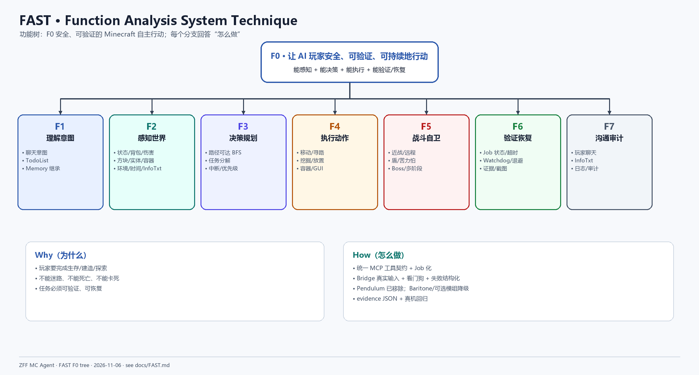
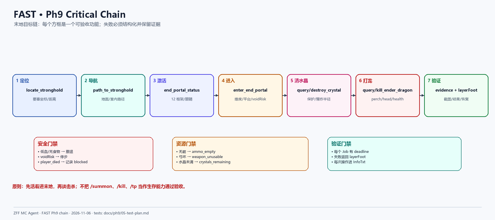

# ZFF MC Agent System — FAST

> 重写日期：2026-11-06  
> 方法：FAST（Functional Analysis System Technique）  
> 重点：从“系统要做什么”拆到可验收的功能，而不是按代码模块罗列。
>
> 图由 Python + Pillow 渲染为 PNG，图片位于 [docs/diagrams](diagrams/)。

## 1. 顶层功能 F0

```text
F0：让 AI 玩家在 Minecraft 中安全、可验证、可持续地行动
```

F0 成立需要四个条件同时满足：

```text
能感知 + 能决策 + 能执行 + 能验证/恢复
```

只有“会打怪”不算完成；只有“能执行但没有证据”也不算完成。

## 2. FAST 功能树



### 2.1 功能分解

| 功能 | 子功能 | 当前状态 |
|---|---|---|
| F1 理解意图 | 聊天意图、TodoList、Memory | 已有；跨会话恢复 |
| F2 感知世界 | 状态/背包/伤害、方块/实体/容器、环境/时间/InfoTxt | 已有 |
| F3 决策规划 | 路径可达 BFS、任务分解、中断/优先级 | 部分；3D/要塞/末地待补 |
| F4 执行动作 | 移动/寻路、挖掘/放置、容器/GUI | 已有；复杂结构稳定性待补 |
| F5 战斗自卫 | 近战/远程、盾/苦力怕、Boss/多阶段 | 地面战斗通过；龙待实现 |
| F6 验证恢复 | Job 状态/超时、Watchdog/退避、证据/截图 | 已有；layerFoot 已接入 |
| F7 沟通审计 | 玩家聊天、InfoTxt、日志/审计 | 已有；COMBAT 多条保留 |

## 3. Why–How

### Why

```text
玩家要完成生存/建造/探索
→ 不能迷路
→ 不能死亡
→ 不能卡死
→ 任务必须可验证、可恢复
```

### How

```text
统一 MCP 工具契约 + Job 化
+ Bridge 真实输入 + Watchdog + 失败结构化
+ 可选模组降级（Baritone/Create/Apotheosis）
+ evidence JSON + 真机回归
```

关键设计选择：

1. **Pendulum 已移除**：不依赖服务端通道，战斗全部内置 Bridge。
2. **真实输入优先**：盾、弓、水桶必须触发服务端认可的真实使用/释放。
3. **失败可读**：`stalled / no_progress / player_died` 之外，还要给出 `layerFoot`。
4. **InfoTxt 不丢操作**：self-protect 的放水、收水、举盾、逃跑都要让 AI 看到。

## 4. 普通任务功能链

```text
玩家意图
→ 感知快照
→ 路径可达检查
→ 创建 Job
→ 客户端 tick 执行
→ 成功 / 失败 / 超时
→ result + health + armor + infoTxt
→ 证据/回复
```

对应工具：

```text
get_state → scan_* → path_to / walk_to → job_status → evidence
```

## 5. 战斗功能链

```text
发现 Enemy
→ 路径 <16 或飞行 LOS 例外
→ 追逐
→ 近战 / 远程
→ 盾/食物/撤退
→ target_killed / player_died / timeout
```

当前通过的能力：

- 近战 `kill_target_close`
- 远程 `kill_target_far`（真实弓 release、箭数下降）
- 苦力怕盾挡（真实右键，盾耐久下降）
- 远程被自卫打断
- 墙后目标不索敌
- 飞行 Blaze 的 LOS 例外

未完成：

- 末地水晶
- 末影龙本体/多阶段
- 虚空边缘保护（`void_guard` 仍是契约）

## 6. Ph9 关键链



### 6.1 链路

```text
定位要塞
→ 导航到传送门房间
→ 检查/补全 12 眼
→ 进入末地
→ 虚空/平台安全
→ 清除水晶
→ 末影龙 perch/飞行阶段
→ 证据
```

### 6.2 目标工具状态

| 步骤 | 目标工具 | 状态 |
|---|---|---|
| 定位 | `locate_stronghold` | 契约，未实现 |
| 导航 | `path_to_stronghold` | 契约，未实现 |
| 激活 | `end_portal_status` / `activate_end_portal` | 契约，未实现 |
| 进入 | `enter_end_portal` | 契约，未实现 |
| 安全 | `void_guard` / `safe_move_to` | 契约，未实现 |
| 水晶 | `query_crystals` / `destroy_crystal` | 契约，未实现 |
| 龙 | `query_dragon` / `kill_ender_dragon` | 契约，未实现 |
| 落地水 | `AutoMlg` | **已实现** |
| 失败可读 | `layerFoot` | **已实现** |
| 操作可见 | InfoTxt `COMBAT:` | **已实现** |

## 7. 门禁（FAST 视角）

| 门禁 | 问题 | 判定 |
|---|---|---|
| 安全门禁 | 低血/无食物/虚空风险时会不会停？ | 停/撤退/记录 |
| 资源门禁 | 无箭/坏弓/水晶未清时会不会硬打？ | 结构化失败 |
| 验证门禁 | 每个 Job 是否有终态和证据？ | deadline + result + evidence |
| 沟通门禁 | self-protect 操作 AI 是否知道？ | InfoTxt 可见 |
| 路径门禁 | 失败时 AI 是否知道卡在哪？ | layerFoot |

## 8. 设计原则

1. 先活着进末地，再谈击杀。
2. 不用 `/summon`、`/kill`、`/tp` 冒充生存能力通过验收。
3. 不把 Pendulum/Baritone/Create/Apotheosis/Serene Seasons 变成硬依赖。
4. 失败必须结构化，不能只写日志。
5. 没有 evidence 的“全绿”不算全绿。

## 9. 相关文档

- [SADT.md](SADT.md)
- [MCP-TOOLS.md](MCP-TOOLS.md)
- [ph9/01-scope-and-goals.md](ph9/01-scope-and-goals.md)
- [ph9/04-tool-contracts.md](ph9/04-tool-contracts.md)
- [ph9/05-test-plan.md](ph9/05-test-plan.md)
- [ph9/07-backlog.md](ph9/07-backlog.md)
- [ph9/13-acceptance.md](ph9/13-acceptance.md)
