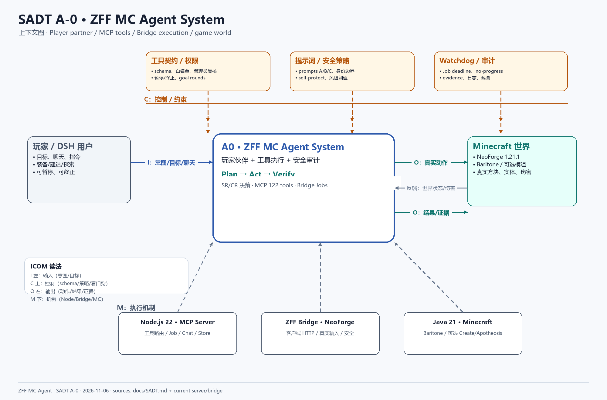
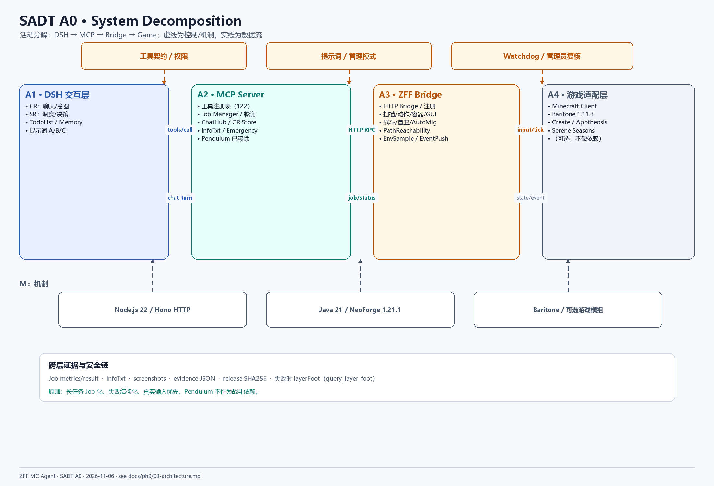

# ZFF MC Agent System — SADT

> 重写日期：2026-11-06  
> 适用版本：ZFF MCP Server 122 tools + ZFF Bridge + DSH `zff-mc-plugin`  
> 重要变更：**Pendulum 方案已全部废弃**。战斗、盾牌、弓、自动落地水全部由 Bridge 原生实现；不再有 Pendulum/Jupiter/Rhino 依赖。
>
> 本文件中的图由 Python + Pillow 渲染为 PNG，图片位于 [docs/diagrams](diagrams/)。

## 1. 为什么用 SADT

SADT 不描述“代码怎么调用”，而是描述：

```text
系统接收什么（Input）
受什么约束（Control）
产生什么（Output）
靠什么执行（Mechanism）
```

对 ZFF 来说，最关键的不是“工具有多少”，而是：

- 玩家意图如何变成可执行任务；
- 工具结果如何进入 AI 的上下文；
- 失败/危险如何被 Watchdog、InfoTxt、证据链捕获；
- 哪些能力是硬依赖，哪些必须可降级。

## 2. A-0 上下文图



### 2.1 ICOM 读法

| 方向 | 含义 | 本系统内容 |
|---|---|---|
| I（左） | Input | 玩家聊天、目标、开发任务、坐标、物品请求、模式切换 |
| C（上） | Control | 工具 schema、权限白名单、提示词 A/B/C、管理员复核、Job deadline、Watchdog、self-protect 阈值 |
| O（右） | Output | 玩家聊天回复、真实游戏动作、Job 结果、InfoTxt、截图、evidence JSON、release |
| M（下） | Mechanism | Node.js 22 MCP Server、ZFF Bridge（NeoForge）、Minecraft、Baritone、可选 Create/Apotheosis |

### 2.2 外部实体

| 实体 | 关系 |
|---|---|
| 玩家 / DSH 用户 | 下达目标、聊天、暂停/终止；接收回复与证据 |
| Minecraft 世界 | 真实方块/实体/伤害/容器；Bridge 只能通过客户端 API 操作 |
| DSH 宿主 | 提供 SR/CR、提示词注入、续跑与管理员下线 |
| 证据系统 | evidence JSON、截图、SHA256、Job metrics |

## 3. A0 分解图



### 3.1 活动说明

| 编号 | 活动 | 输入 | 控制 | 输出 | 机制 |
|---|---|---|---|---|---|
| A1 | DSH 交互层 | 玩家消息、任务 | 提示词、模式、管理员名单 | SR 计划、CR 回复、Todo/Memory | CR/SR、Prompt、Store |
| A2 | MCP Server | `tools/call`、Job 轮询 | schema、timeout、暂停/终止 | 工具 JSON、Job 状态、InfoTxt、证据 | Node/Hono、Jobs、ChatHub |
| A3 | ZFF Bridge | HTTP RPC | 协议版本、注册心跳、Watchdog | 世界快照、动作结果、战斗结果 | Java、NeoForge、真实输入 |
| A4 | 游戏适配层 | 移动/攻击/放置/扫描 | 客户端 tick、权限、碰撞 | 真实世界变化 | Minecraft、Baritone、可选模组 |

### 3.2 关键边界

```text
A1 不直接碰游戏
A2 不直接读写 Minecraft 内存
A3 拥有真实玩家控制权
A4 决定“物理上能不能做”
```

这条边界是安全模型的基础：任何“AI 说做了”都必须经过 A3/A4 的真实执行与回读。

## 4. 数据流

### 4.1 普通工具

```text
Agent → MCP tools/call → Bridge HTTP → Client Tick → Game
      ← JSON + infoTxt ← 结果/错误 ← 状态回读
```

### 4.2 长任务

```text
Agent → tool → Bridge Job(queued) → jobId
Agent → job_status(jobId) → running/metrics
      → done/failed/cancelled + result
```

约束：

- HTTP 调用不阻塞到任务完成；
- Job 必须有 deadline；
- 移动/挖掘/战斗必须有 no-progress 退出；
- 失败必须返回结构化 `reason/error`。

### 4.3 寻路失败

```text
path_to / path_open / walk_to / walk 失败
→ job_status / path_status 自动附 layerFoot
→ layerFoot 来自 query_layer_foot 的 15×15 脚部平面
```

这让 AI 能看到“为什么走不过去”，而不是只收到一个 `stalled`。

### 4.4 InfoTxt

```text
Bridge EventPush → daemon /event → MCP EmergencyState
→ 下一次工具响应 infoTxt（拉取后清零）
```

当前 `COMBAT:` 保留最近最多 8 条，保证 self-protect 的连续操作不会互相覆盖：

```text
COMBAT: self-protect: auto MLG water placed ...
COMBAT: self-protect: auto MLG water recovered ...
```

## 5. 控制与安全

| 控制 | 落点 | 目的 |
|---|---|---|
| Tool schema | `server.js` `reg()` | 拒绝错误参数 |
| 权限/模式 | DSH plugin / profile | MC 模式只暴露允许工具 |
| 提示词 | `prompts/{tools,rules,persona}.md` | 身份、交流、行为边界 |
| Watchdog | Bridge `ProgressWatch` / `ZffWatchdog` | 无进展退出；tower 阈值 1.5 格 |
| self-protect | `SelfProtect` + `AutoMlg` | 苦力怕盾/逃、自动落地水、收水 |
| 管理员复核 | `zff_shutdown` + `chat_history` | 防止非管理员下线 |
| 证据 | evidence + screenshots + SHA256 | 可复现、可审计 |

## 6. Ph9 的新增活动

Ph9 不是简单“加几个工具”，而是补全端到端链路：

```text
要塞定位 → 传送门激活 → 进入末地 → 虚空保护
→ 水晶处理 → 末影龙多阶段战斗 → 证据
```

对应活动：

| 活动 | 当前状态 |
|---|---|
| `locate_stronghold` / `path_to_stronghold` | 契约已定义，未实现 |
| `end_portal_status` / `activate_end_portal` | 契约已定义，未实现 |
| `enter_end_portal` / `void_guard` | 契约已定义，未实现 |
| `query_crystals` / `destroy_crystal` | 契约已定义，未实现 |
| `query_dragon` / `kill_ender_dragon` | 契约已定义，未实现 |
| AutoMlg + water recovery | **已实现并真机通过** |
| tower watchdog 1.5 格 | **已实现** |
| 寻路失败 layerFoot | **已实现** |

## 7. 设计结论

1. **Pendulum 不是依赖**：服务端通道不可控，战斗必须内置 Bridge。
2. **真实输入优先**：盾/弓/水桶必须走真实右键/释放，不能用客户端假状态。
3. **Job 化**：所有长动作有 deadline 和退出条件。
4. **失败可读**：结构化 error + layerFoot + InfoTxt。
5. **证据先于宣称**：没有 evidence 的“通过”不算通过。

## 8. 相关文档

- [FAST.md](FAST.md)
- [MCP-TOOLS.md](MCP-TOOLS.md)
- [ph9/03-architecture.md](ph9/03-architecture.md)
- [ph9/04-tool-contracts.md](ph9/04-tool-contracts.md)
- [ph9/05-test-plan.md](ph9/05-test-plan.md)
- [ph9/13-acceptance.md](ph9/13-acceptance.md)
