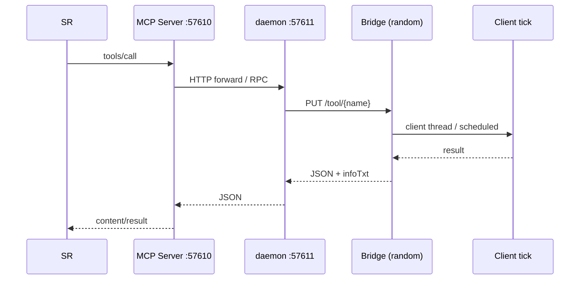
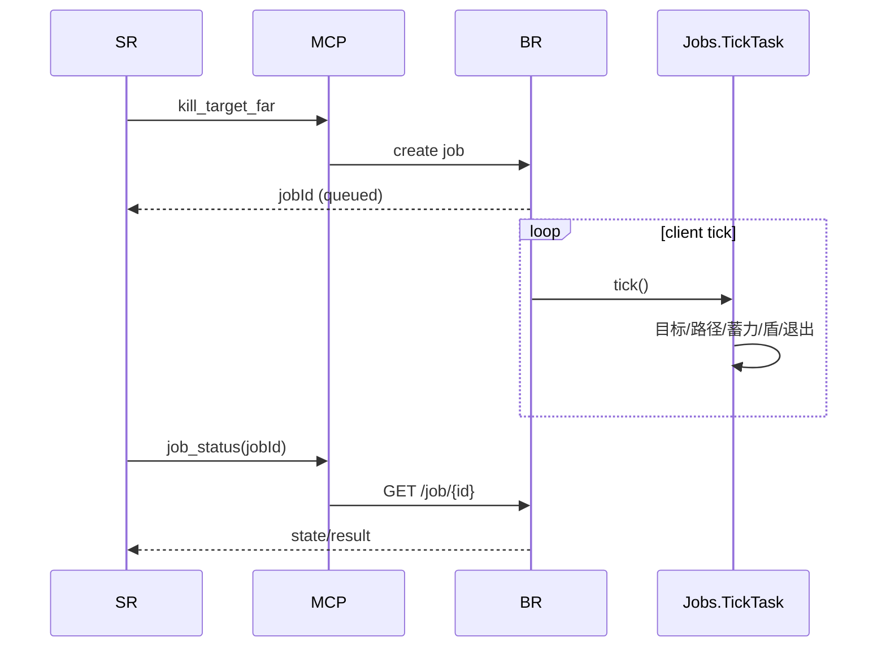

# 03 — Ph9 架构

> 上层图见 [../SADT.md](../SADT.md) 与 [../FAST.md](../FAST.md)。

## 1. 组件

```text
DSH (SR/CR)
  │ MCP client
  ▼
ZFF MCP Server (Node.js, 127.0.0.1:57610)
  ├─ tool registry / schema (122 tools)
  ├─ Job manager + polling
  ├─ ChatHub (57612 internal ingest)
  ├─ CR Store / Memory
  ├─ EmergencyState / InfoTxt
  └─ Pendulum TCP router (127.0.0.1:25566)
        │ HTTP bridge RPC
        ▼
ZFF Bridge (NeoForge client+server mod)
  ├─ HttpBridge (random 127.0.0.1 port)
  ├─ Jobs (client tick)
  ├─ scan / action / inventory / GUI
  ├─ Combat jobs
  ├─ EnvSampler / EventPush
  └─ PathReachability / safety
        │ Minecraft APIs
        ▼
Minecraft 1.21.1 + NeoForge
  ├─ Baritone 1.11.3 (optional)
  ├─ Pendulum 1.0 + Jupiter + Rhino (optional)
  └─ Create / Apotheosis / Serene Seasons (optional)
```

## 2. 端口与进程

| 端口 | 进程 | 说明 |
|---|---|---|
| 57610 | Node MCP Server | 公共 MCP HTTP |
| 57611 | Node daemon | 处理聊天/注册/HTTP 转发 |
| 57612 | internal ingest | 游戏 mod 推送 event/chat，不对外 |
| 随机端口 | ZFF Bridge | 每个客户端实例独立，注册 JSON 记录 |
| 25566 | Pendulum MCP | 客户端内，短 TCP 连接，随游戏关闭 |

## 3. 一次工具调用



## 4. 一次 Job



## 5. Ph9 新增组件（建议）

```text
EndProgression
  ├─ StrongholdLocator
  ├─ PortalRoomNavigator
  ├─ EndPortalController
  ├─ EndEntryGuard
  └─ VoidGuard

DragonCombat
  ├─ CrystalManager
  ├─ DragonTracker
  ├─ DragonPhaseController
  └─ DragonAttackPlanner

ToolContracts
  ├─ structured error codes
  ├─ result schema
  └─ evidence recorder
```

## 6. 数据边界

| 数据 | 存放 | 生命周期 |
|---|---|---|
| 玩家聊天 | ChatHub（内存 + rules 文件） | 会话 |
| CR Store | `<workspace>/.mcp-agent` / store | 跨会话 |
| Memory | `<workspace>/.mcp-agent` | 跨会话 |
| Job | Bridge 内存 | 游戏进程 |
| 证据 | `evidence/*.json` | 永久 |
| 配置 | `$DSH_HOME/whale_craft/config.json` / `zff_bridge.config` | 永久 |

## 7. 兼容与降级

| 缺失组件 | 行为 |
|---|---|
| Baritone | `path_to` 受限；纯地面短距移动仍可用 |
| Pendulum | `pendulum_*` 工具返回 unavailable；战斗回落 Bridge |
| Create | `create_*` 返回 unsupported |
| Apotheosis | GUI 通用协议仍可用，适配器退化 |
| Serene Seasons | `query_env_info.season.available=false` |
| End 维度不可用 | 返回 `dimension_unavailable`，不崩溃 |

## 8. 关键设计决策

1. Client-side bridge 拥有实际玩家控制权；MCP 不直接操作游戏内存。
2. 长动作必须 Job 化，HTTP 调用立即返回。
3. 真实输入优先：`mouseRight`/`keyUse`/`gameMode.releaseUsingItem`。
4. 路径可达是索敌硬门槛；飞行的 Blaze/EnderDragon 用 LOS 例外。
5. Pendulum 只作可选增强；不接管 MCP 主链路。
6. 证据与文档先于“宣称完成”。

## 9. Ph9 实现顺序

```text
1. Stronghold/Portal 工具
2. EndEntryGuard/VoidGuard
3. CrystalManager
4. DragonTracker/Phase
5. kill_ender_dragon
6. 回归 + release
```
